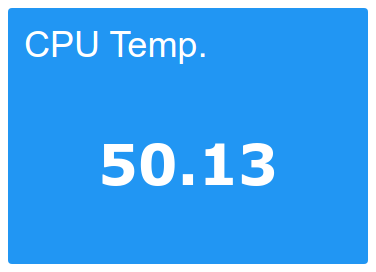
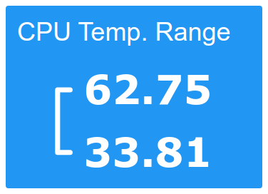
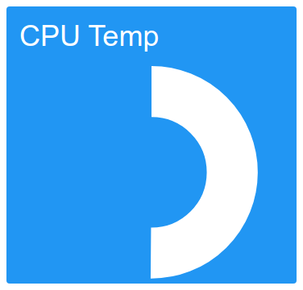
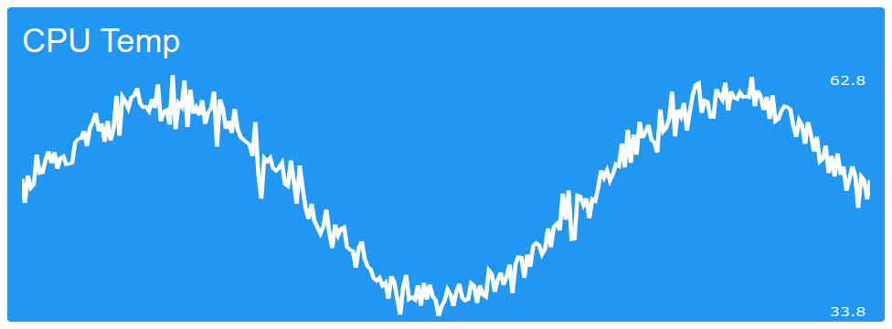

# Slapdash

*Slap up a dashboard in minutes or less*

Slapdash is a data dashboard that's focused on simplicity and ease of use. If you need a dashboard and you want something quick, simple and free then this is for you.

Here is a [real life example](https://dash.9acres.uk)

## Installation

First [Install Rust](https://www.rust-lang.org/tools/install), then:

```bash
cargo install slapdash
```

## Usage

### Start the slapdash server:

```bash
slapdash serve &
```

### Push data to the dashboard

All data in Slapdash is numerical and each data `point` is contained in a single named `series`.

To add a data `point` to a given `series` simply make an HTTP GET request to:

```
http://localhost:8080/<secret>/<series name>/<point value>
```

For example

```bash
curl http://localhost:8080/dDO1fgpw6LPWs3ciZCTnpdr7yaPQbzTG/cpu_temperature_c/41.45
```

The `secret` is a secret number that is generated by Slapdash and can be found in the file `~/.slapdash/config.txt`.

Alternatively you can run:

```bash
slapdash push <series name> <point value>
```

### View your dashboard

Your dashboard is online at [http://localhost:8080](http://localhost:8080).

Slapdash can serve multiple dashboards, each at `http://localhost:8080/<dashboard name>`. There is a `default` dashboard which is served if no dashboard name is specified.

Each widget can also be viewed on its own at `http://localhost:8080/<dashboard name>/<widget index>`, where the index is the widget's 0-based position in the dashboard file. Click any widget to open its page.

### Create a new dashboard

```bash
slapdash dashboard new my_amazing_dashboard
```

### Edit a dashboard

Each dashboard is configured by the file `~/.slapdash/dashboards/<dashboard name>.xml`. Use you favorite code editor to edit the configuration file. You should get autocomplete and validation due to the provided schema file. Changes to dashboard files take effect immediately on save.

## Dashboard configuration

The dashboard configuration defines what widgets are on your dashboard and how they are arranged. There are several types of widgets and layout components:

### Layout Components

Layout components arrange the widgets on your dashboard. They can contain widgets and other layout components. They may also specify default values for `color`, `width` and `height` of any contained widgets:

```xml
<row widget_width="3" widget_height="2" widget_color="DeepOrange">
</row>
```

#### Row

A horizontal stack of components. It can contain widgets, rows and columns.

```xml
<row>
    <!-- ... widgets -->
</row>
```

#### Column

A vertical stack of components. It can contain widgets, rows and columns.

```xml
<column>
    <!-- ... widgets -->
</column>
```

### Widgets

Widgets display data on your dashboard. All widgets have attributes for `color`, `width` and `height`, which are optional.

#### Time range

A link to set the time range for the displayed data. By default data for the last 24 hours is shown but you can show data for any range ending in the present. Set the range attribute to a number of seconds.

```xml
<range range="3600" label="1h" />
```


#### Label

A hardcoded text display widget. Good for making titles to dashboard sections.

```xml
<label text="Hello, world!" />
```


#### Freshness

Displays the number of minutes since the last update to the given series.

```xml
<freshness series="cpu_temp_c" />
```


#### Value

A textual display of the latest value of the given series.

```xml
<value series="cpu_temp_c" label="CPU Temp." />
```



#### MinMax

Displays the minimum and maximum values of the given series within the selected time range, with the maximum at the top and the minimum at the bottom.

```xml
<minmax series="cpu_temp_c" label="CPU Temp. Range" />
```



#### Gauge

Displays a gauge type widget which shows the latest value of the given series relative to given maximum and minimum values.

```xml
<gauge series="cpu_temp_c" min="0" max="100" label="CPU Temp" />
```



#### Line

A line chart of the history of the given series over the past 24 hours.

```xml
<line series="cpu_temp_c" label="CPU Temp" />
```




